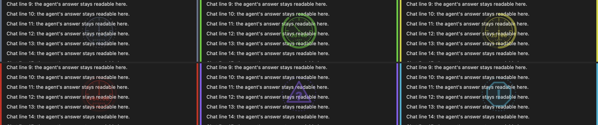

# Agent Windows

Run several AI coding agents side by side in VS Code on a Mac, and see at a
glance which one is waiting for you.

One click opens a grid of VS Code windows on your project, each a chat with
Claude Code, Codex or GitHub Copilot. A clock drawn over every window shows
what its agent is doing, a sound tells you when one needs you, and the menu bar
shows how much of each subscription's quota is left.



*An agent that is working, the countdown after it answered (green, yellow,
overdue), an agent with a question for you, and one that needs a permission.*

## What is in it

| Part | What it does |
| --- | --- |
| **Agent Launcher** (app) | Opens 1–24 VS Code windows on a project folder and tiles them across your displays. [More](AgentLauncher/README.md) |
| **AI Service Switcher** (VS Code extension) | Switches an agent window between Codex, Claude Code and GitHub Copilot (⌘⌥M); each window remembers its service. [More](service-switcher/README.md) |
| **Reply Clock** (app) | Draws the clock and the colored frame over each agent window and plays the sounds. [More](ReplyClock/README.md) |
| **UsageBar** (menu bar app) | Shows the quota left for Claude, Copilot and Codex and how many agents are running; holds Reply Clock's settings. |

The four are separate programs that share one convention: the launcher titles
its windows `Agent N [launcher-…]`, and the others act only on windows with
such a title. You can leave a part out, with two ties: Reply Clock needs the
AI Service Switcher to know which window a chat runs in, and its settings are
in UsageBar's menu.

## Requirements

- macOS 13 or later.
- Apple's command line tools, for the Swift compiler and Python 3
  (`xcode-select --install`). Nothing else is downloaded or installed with a
  package manager.
- Visual Studio Code, with the extension of each service you want to use:
  Claude Code, Codex (the ChatGPT extension) or GitHub Copilot.
- Optional: the GitHub CLI (`gh`), signed in, for UsageBar's Copilot meter.

## Install

```bash
git clone https://github.com/pi-rnn/agent-windows.git
cd agent-windows
./install.sh            # add --login to start Reply Clock and UsageBar at login
```

The script builds the three apps into `~/Applications`, installs the extension
into VS Code and adds the hooks that report each chat's state. Then:

1. **Allow Accessibility access** for Reply Clock when macOS asks (System
   Settings > Privacy & Security > Accessibility). It needs this to follow the
   windows it draws over. Agent Launcher asks for the same, and for System
   Events under Automation, the first time it moves windows.
2. **Codex only:** trust the new hooks (`/hooks` in the Codex CLI, or
   Settings > Hooks). Codex does not run hooks you have not approved.
3. Open **Agent Launcher** from the Desktop, choose a project folder and the
   number of windows, and click **Open agent windows**.

A window shows no clock until its first prompt. Windows that were open before
the install need a reload (Developer: Reload Window) to pick up the extension
and the hooks.

Run `./install.sh` again to update. Because the apps are built on your Mac and
not signed by a developer account, macOS treats a rebuilt app as a new one:
after an update, remove Reply Clock's old entry under Accessibility and add it
again.

## Using it

- **The clock** counts down a reply window (30 minutes unless you change it)
  from the moment an agent answers, turning from green to red, then OVERDUE.
  A violet **?** means the agent asked you a question, a cyan **!** that it
  waits for a permission. The frame around the window has the same color.
- **Sounds** mark an answer, 5 minutes left, a question, a permission, every
  7 minutes an agent has been working, and a quota dropping under 50%, 20%,
  10% and 0%. They are macOS system sounds; to use your own, see
  [Reply Clock's README](ReplyClock/README.md#sounds).
- **UsageBar's menu** lists every quota with its reset time and holds the
  settings: reply window, clock opacity, size and position, sound volume.
  Its icon shows the lowest quota left and appears only while VS Code runs.
- **⌘⌥M** in an agent window picks the service; ⌘⌥1, ⌘⌥2 and ⌘⌥3 go straight
  to Codex, Claude Code and Copilot.

## What it reads and changes on your Mac

Nothing is sent anywhere except the two quota requests below, and there is no
telemetry.

- **Apps:** `Agent Launcher.app`, `ReplyClock.app` and `UsageBar.app` in
  `~/Applications`, and a shortcut to the launcher on the Desktop.
- **VS Code:** one extension, and four key bindings in `keybindings.json` that
  apply only in agent windows.
- **Hooks:** entries in `~/.claude/settings.json` and `~/.codex/hooks.json`,
  and the file `~/.copilot/hooks/reply-clock.json`. A hook records which state
  its window is in (working, finished, asking); it never blocks or alters a
  chat.
- **Files of its own:** `~/Library/Application Support/ReplyClock` (window
  states, a log of hook runs and sounds, your own sounds) and
  `~/Library/Application Support/AgentLauncher` (the workspace file of each
  agent window).
- **What Reply Clock reads:** the end of each service's own session log, to
  notice a turn that was interrupted or failed. Its log keeps event names and
  ids, never what was said.
- **What UsageBar reads:** Claude Code's login token from your Keychain, which
  it sends only to Anthropic (`api.anthropic.com/api/oauth/usage`) to ask for
  your usage; the GitHub CLI's token, sent only to GitHub
  (`api.github.com/copilot_internal/user`) for the Copilot quota; and Codex's
  local session files for its limits. Neither endpoint is a documented API.

Every settings file is backed up next to itself before the installer changes
it (`….before-…-<date>`).

## Uninstall

```bash
./uninstall.sh
```

This quits and removes the apps, the hooks, the extension and Reply Clock's
files. It leaves the four key bindings (they do nothing outside agent windows)
and `~/Library/Application Support/AgentLauncher`, so your agent windows can
come back if you install again; delete that folder if you do not want them.

## Limits

- macOS only, and VS Code's stable release.
- The services do not offer a stable interface for any of this. The clock
  relies on their hooks and session logs and the quota meters on undocumented
  endpoints, as they were in Claude Code 2.1, the Codex extension 26.11 and
  VS Code 1.147 (November 2026). An update of a service can break a part until
  this is adjusted. [Reply Clock's README](ReplyClock/README.md) says what is
  read from where and how to find out why a window shows the wrong thing.
- A turn that ends because the credits ran out is recognized for Claude Code
  and Copilot, not for Codex.
- A new agent window opens on Codex. If you use another service, pick it once
  per window with ⌘⌥M.

## Tests

```bash
python3 -m unittest                                         # window layout and key bindings
~/Applications/ReplyClock.app/Contents/MacOS/ReplyClock --selftest
~/Applications/UsageBar.app/Contents/MacOS/UsageBar --selftest
```

Both builds run their app's self-test.

## AI declaration

This tool was created together with Claude, Anthropic's AI model, used through
Claude Code. The ideas, the requirements and the testing in daily use are the
author's; the code and the documentation were largely written by Claude at the
author's direction.

## License

[MIT](LICENSE). This is an independent project, not affiliated with or endorsed
by Anthropic, OpenAI, GitHub or Microsoft.
